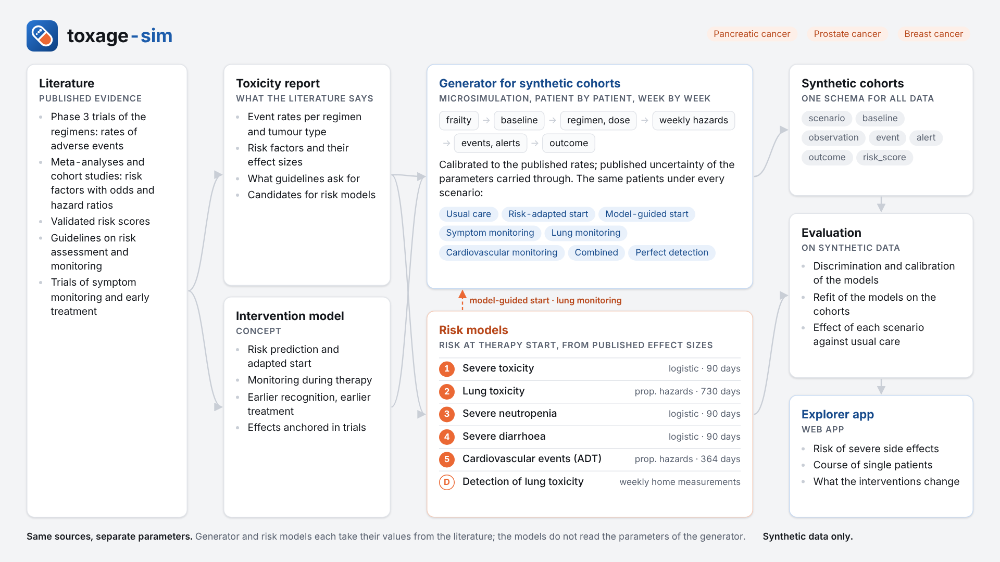

# background

Scientific background and concepts of the project.

- [references.md](references.md): the literature list in APA style, with the status of each full text.
- [toxicity-report.md](toxicity-report.md): what the references say about toxicity of systemic cancer therapy, what guidelines ask for, and which risk models follow from this.
- [intervention-model.md](intervention-model.md): concept for modelling interventions and their effects in the microsimulation.
- `papers/`: PDFs of the references.
- [figures/](figures/): figures for talks and for the app, one per risk model and an overview of the project. `just figures` builds them from the model configuration (`build.py`) and renders them as PNG (`render.mjs`).

